<div align="center">

  

  # Multron Win Cleaner

  **Modern, hafif ve topluluk destekli Windows sistem iyileştiricisi.**  
  Tamamen ücretsiz ve açık kaynak; abonelik, ücretli kilit veya arka planda veri toplama yok.

  <p align="center">
    <a href="https://github.com/Multron-Community/MultronWcleaner/releases">
      
    </a>
    <!-- downloads-badge:start -->
    <a href="#downloads">
      
    </a>
<!-- downloads-badge:end -->
    
    
    <a href="https://github.com/Multron-Community/MultronWcleaner-Database">
      
    </a>
    <a href="LICENSE">
      
    </a>
    <a href="https://github.com/Multron-Community/MultronWcleaner/actions/workflows/build.yml">
    
  </a>
  </p>

  [Sürümü İndir](https://github.com/Multron-Community/MultronWcleaner/releases/latest) • [Veritabanı Deposu](https://github.com/Multron-Community/MultronWcleaner-Database) • [Motor Deposu](https://github.com/HydraDragonAntivirus/HydraDragonAntivirus) • [Sorun Bildir](https://github.com/Multron-Community/MultronWcleaner/issues) • [Patreon'da Destekle](https://www.patreon.com/cw/multron)

  ### Lütfen Bir Dil Seçin

  [](README.md)
  [](README.tr.md)

---

<div align="center">
  <a href="https://www.youtube.com/watch?v=FW3Ok223CQM" target="_blank">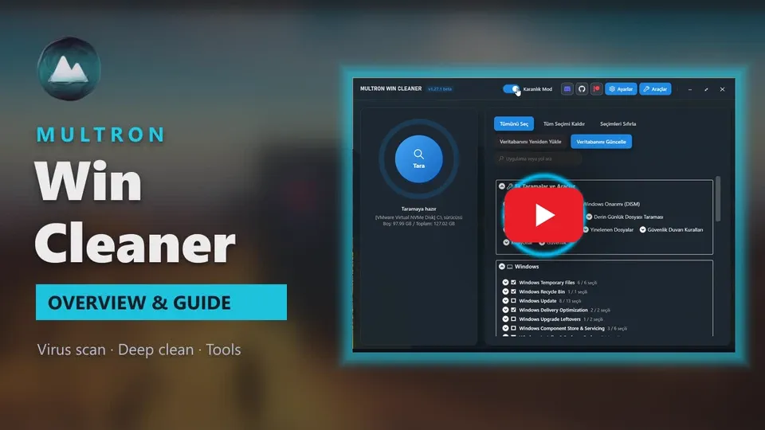</a>
  <a href="https://www.youtube.com/watch?v=dEVvZb2j_eY" target="_blank">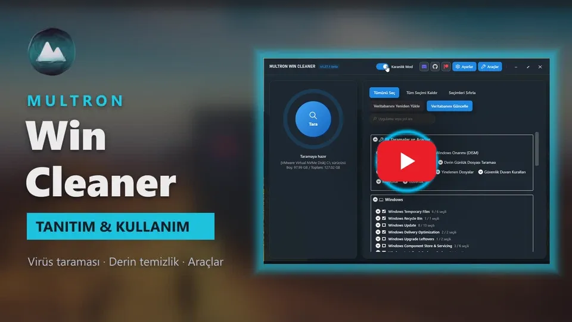</a>
  <p><b>🇬🇧 English</b> &nbsp;·&nbsp; <b>🇹🇷 Türkçe</b><br><i>Videonun tamamını YouTube'da izlemek için bir görsele tıklayın.</i></p>
</div>

---

</div>

> [!WARNING]
> **Antivirüs yanlış alarmları:** Bazı antivirüs programları Multron Win Cleaner'ı veya DLL dosyalarından birini indirirken ya da çalıştırırken şüpheli olarak işaretleyebilir. Özellikle **Bitdefender** ve onu kullanan motorlar (örneğin Emsisoft, eScan, GData, Arcabit, VIPRE), `MultronWinCleaner.dll` dosyasını `Gen:Heur.Ransom.Imps.3` gibi bir adla **sezgisel olarak fidye yazılımı** diye algılayabilir. Bu bir yanlış alarmdır: sezgisel algılama bilinen bir zararlı imzasına değil davranışa dayanır ve bir sistem temizleyicinin yapmak zorunda olduğu işlerle (programları kapatmak, dosya silmek, Windows ayarlarını değiştirmek) tetiklenir. Multron Win Cleaner dosyaları şifrelemez, fidye istemez ve isteğe bağlı bulut zararlı yazılım taraması dışında verilerinizi hiçbir yere göndermez. Dosya Bitdefender'a yeniden yanlış alarm olarak bildirildi. Kaynak kodun tamamı bu depoda ve her sürüm GitHub Actions ile otomatik olarak derleniyor. Antivirüsünüz uygulamayı engellerse dosyayı üreticisine yanlış alarm olarak bildirebilir veya uygulama klasörü için bir istisna ekleyebilirsiniz.
>
> * Bitdefender yanlış alarm formu: <https://www.bitdefender.com/consumer/support/answer/29358/>
> * Microsoft Defender dosya gönderimi: <https://www.microsoft.com/en-us/wdsi/filesubmission>

---

## Ekran Görüntüleri

<div align="center">
  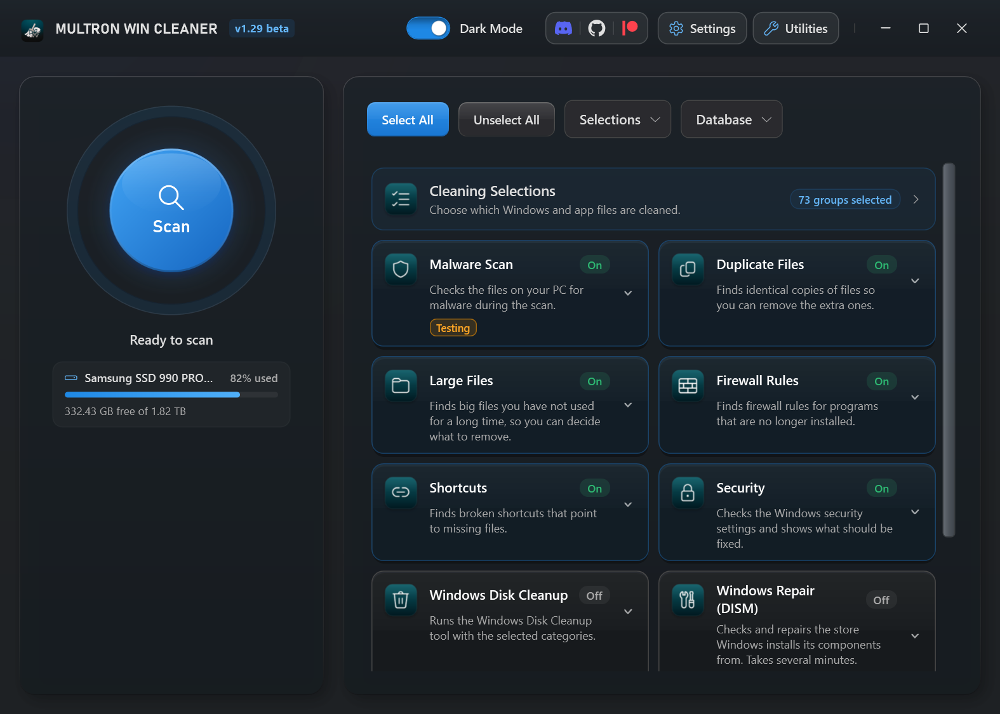
</div>

<table>
  <tr>
    <td align="center">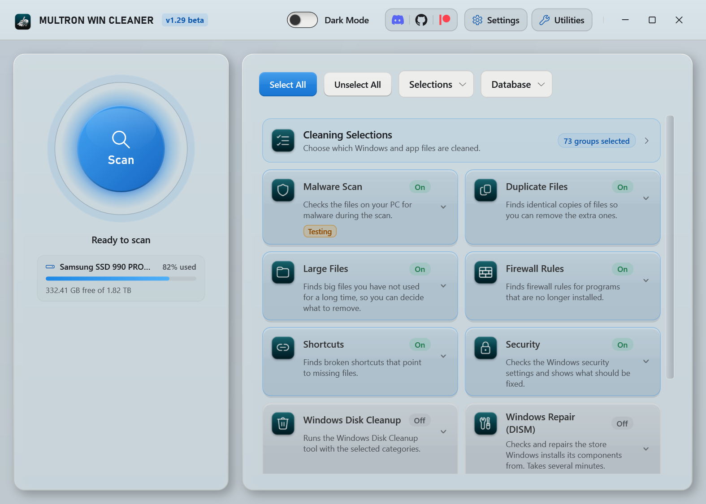<br/><b>Açık mod</b></td>
    <td align="center">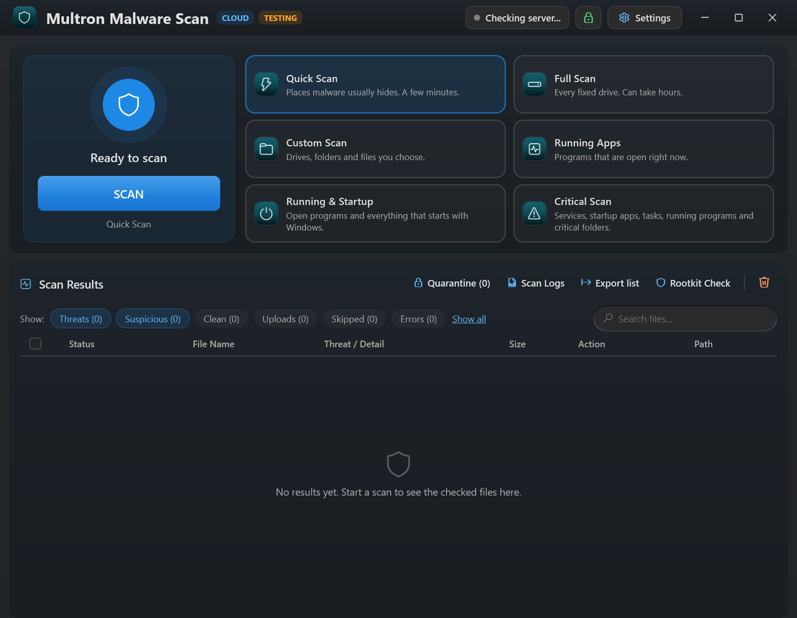<br/><b>Multron Zararlı Yazılım Taraması</b></td>
  </tr>
  <tr>
    <td align="center">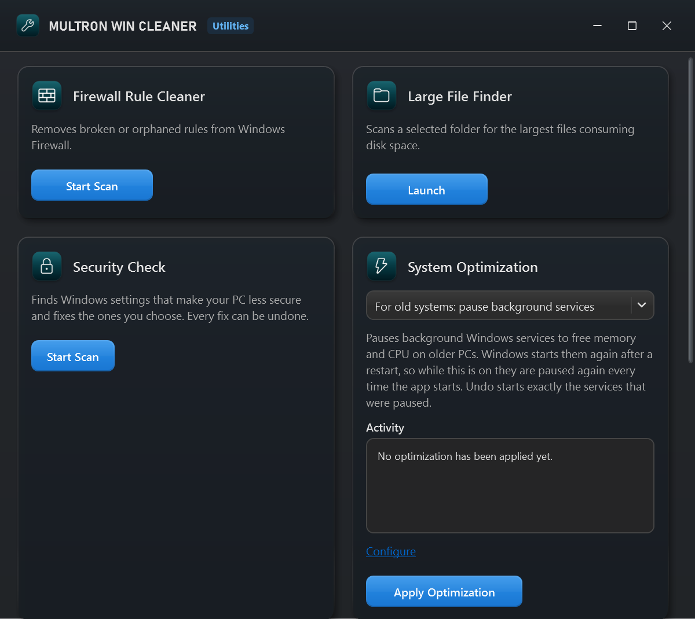<br/><b>Araçlar</b></td>
    <td align="center">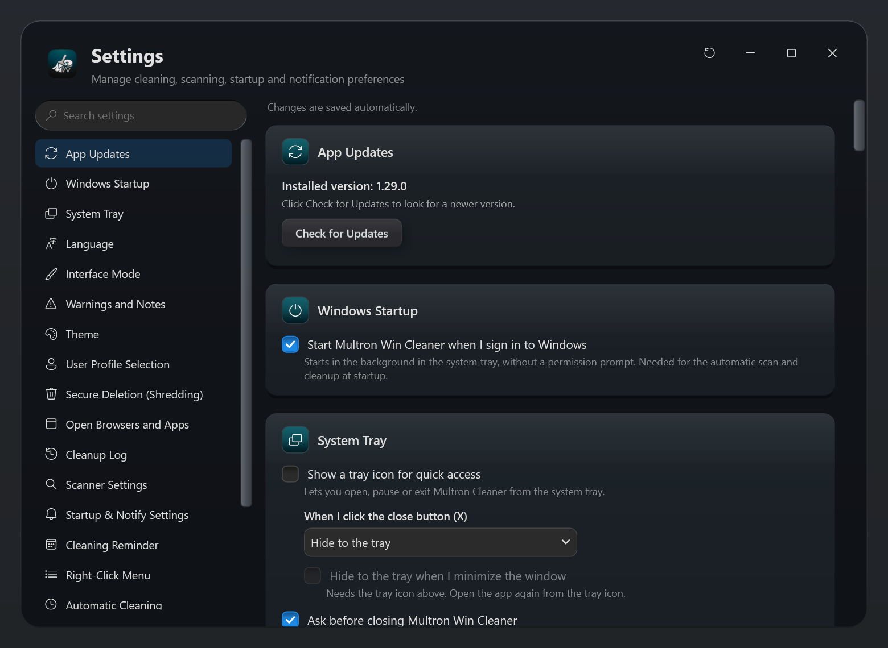<br/><b>Ayarlar</b></td>
  </tr>
  <tr>
    <td align="center">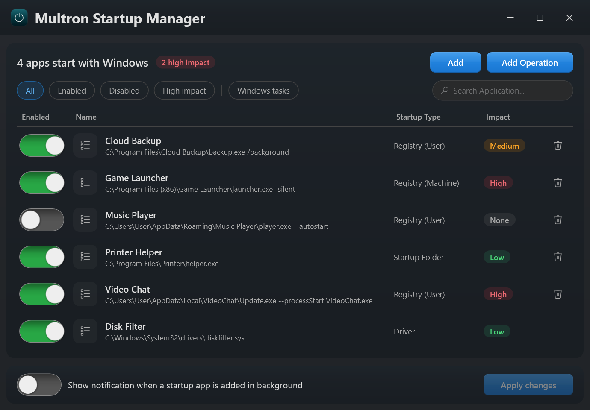<br/><b>Başlangıç Yöneticisi</b></td>
    <td align="center">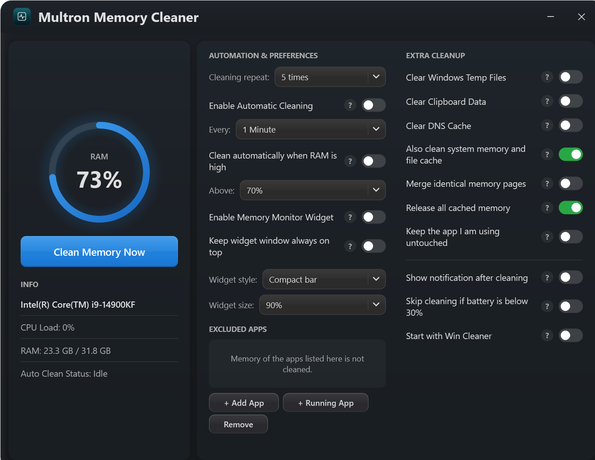<br/><b>Bellek Temizleyici</b></td>
  </tr>
  <tr>
    <td align="center">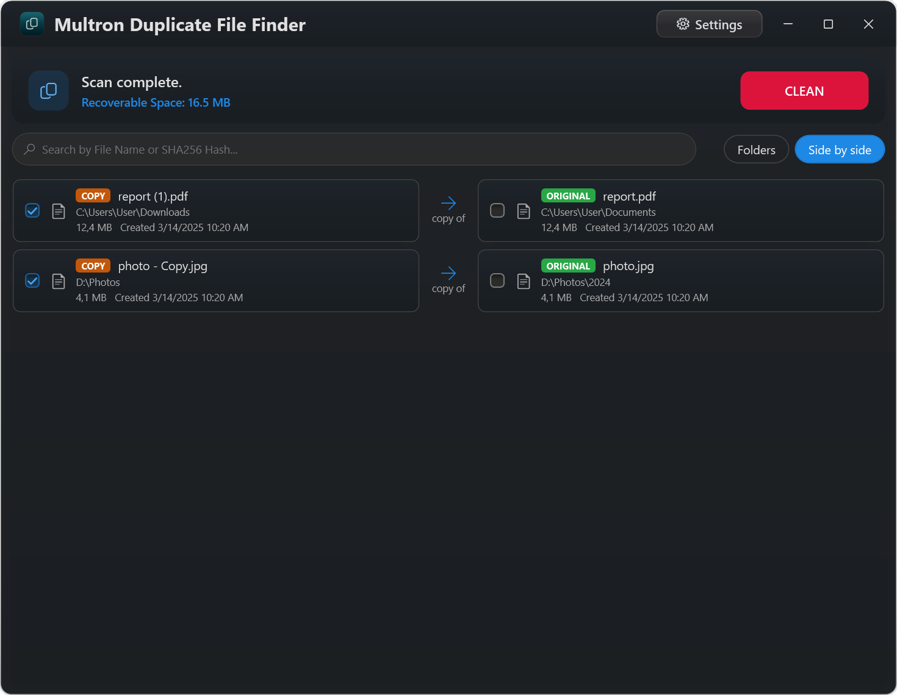<br/><b>Yinelenen Dosya Bulucu</b></td>
    <td align="center">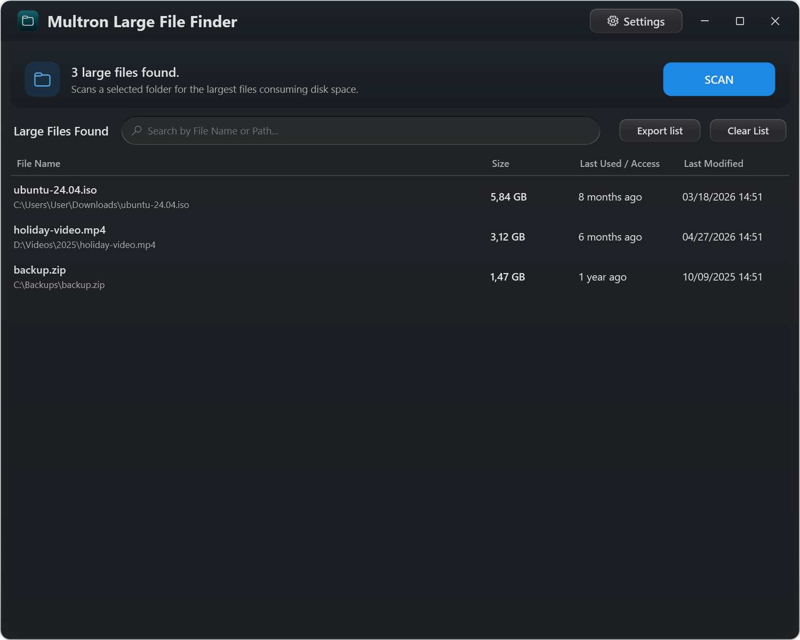<br/><b>Büyük Dosya Bulucu</b></td>
  </tr>
</table>

<div align="center">
  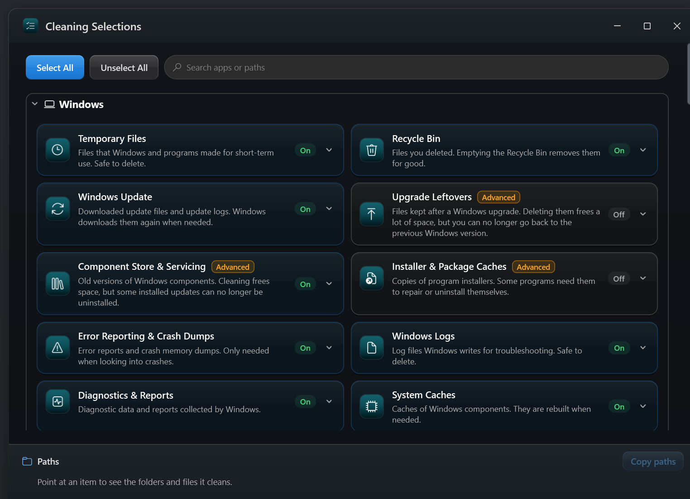<br/><b>Temizlik Seçimleri</b>
</div>

---

## Genel Bakış

**Multron Win Cleaner**, Windows için tasarlanmış kapsamlı bir sistem bakımı, güvenlik ve disk alanı kazanma paketidir. Sıradan temizlik araçlarından farklı olarak derin, düşük seviyeli sistem denetimlerini (DISM, SFC, WinSxS, açılışta yapılan işlemler) şeffaf ve topluluk tarafından güncellenebilen temizlik tanımlarıyla birleştirir. Tek bir tarama; gereksiz dosyaları, sistem sağlığını, güvenlik duvarı kurallarını, kısayolları, güvenlik ayarlarını ve yinelenen dosyaları birlikte kontrol eder.

Uygulama **12 dile** tamamen çevrilmiştir: İngilizce, Türkçe, Almanca, İspanyolca, Fransızca, İtalyanca, Brezilya Portekizcesi, Rusça, Japonca, Korece, Basitleştirilmiş Çince ve Geleneksel Çince.

---

## Temel Özellikler

### 🧹 Derin Sistem Temizliği
* **Uygulama Kuralları:** Üçüncü taraf yazılımlar, tarayıcı önbellekleri ve geçici veriler için sürekli güncellenen tanımlar.
* **Modüler Kural Veritabanı:** Temizlik hedefleri ayrı bir [`database.txt`](https://github.com/Multron-Community/MultronWcleaner-Database) deposunda tutulur; topluluk, uygulamanın kendisini değiştirmeden anında katkıda bulunabilir. Her uygulama kaydı kendi grubunu da (Tarayıcılar, İnternet ve İletişim, Oyunlar...) taşır; böylece liste her bilgisayarda aynı şekilde sıralanır.
* **Derin Log Taraması:** C: sürücüsündeki log, döküm, geçici ve yedek dosyaları bulup kaldırır. Varsayılan olarak `.log`, `.etl`, `.dmp`, `.mdmp`, `.hdmp`, `.wer`, `.trace`, `.tmp`, `.temp`, `.bak`, `.old`, `.chk`, `.err`, `.gid` ve `.swp` dosyalarını arar (liste Ayarlar'dan değiştirilebilir ve hatırlanır). İsteğe bağlı filtreler son N gün içinde değişen dosyaları (hâlâ yazılan logları) ve N KB'tan küçük dosyaları atlar. Bağlantı noktaları (junction) ve sembolik bağlantılar takip edilmez; böylece C: dışında hiçbir şeye dokunulmaz ve hiçbir dosya iki kez sayılmaz.
* **Yaşa Göre Dosya Filtreleri:** Oluşturma veya son erişim tarihine göre yalnızca belirlenen gün sayısından eski dosyaları hedefleyin.
* **İstisnalar:** Dosyaları ve klasörlerin tamamını tarama ve temizlikten hariç tutun.
* **Kaydedilen Seçimler:** İşaretlediğiniz konumlar ve komutlar hatırlanır; tek tıkla **Seçimleri Sıfırla** düğmesi vardır.
* **Yerleşik cleanmgr Erişimi:** Windows Disk Temizleme ön ayarları otomatik temizlik sırasında arka planda sessizce çalışır. Dört Disk Temizleme komutundan yalnızca biri seçilebilir; hepsi aynı aracı çalıştırdığı için birini seçmek diğerlerinin işaretini kaldırır.
* **İnatçı Gereksiz Dosyaların Kaldırılması:** İlk denemede silinmeyen bir dosya güçlü ve sürücü gerektirmeyen bir silmeye yükseltilir: salt okunur/gizli/sistem öznitelikleri temizlenir, uzun `\\?\` yolları kullanılır, bir uygulamanın hâlâ açık tuttuğu dosyaları kaldıran NTFS POSIX silme yapılır ve direnen az sayıdaki dosya için sahiplik alınıp izinler sıfırlanır. Böylece taramanın bulduğu dosyaların çok daha fazlası gerçekten temizlenir. Yöneticinin zaten sahip olduğu yedekleme/geri yükleme ayrıcalıkları açılır, izinlerle kilitli dosyalar doğrudan silinir; hâlâ çalışan bir Windows hizmetinin tuttuğu dosya "erişim reddedildi" olarak bırakılmak yerine bir sonraki yeniden başlatmada silinmek üzere işaretlenir. Temizlik sırasında hiçbir zaman işlem sonlandırılmaz veya yeniden başlatma zorlanmaz. Dosyalar paralel silinir (testimizde SSD'de yaklaşık 3,5 kat daha hızlı). Sıradan bir programın tuttuğu dosya **Sonlandır** listesine gider; yalnızca Windows'un veya bir Windows hizmetinin tuttuğu dosya bir sonraki yeniden başlatmada silinmek üzere işaretlenir. Bu dosyaların her biri temizlikten sonra listelenir ve ana pencerede **Yeniden başlat** düğmesiyle vurgulu bir **Temizlik bitti! Yeniden başlatma gerekli.** kutusu görünür.
* **Güvenli Silme (Parçalama):** **Ayarlar**'daki isteğe bağlı bir seçenek, dosyaları silmeden önce üzerlerine yazarak kurtarılamaz hale getirir. **SSD'ye duyarlıdır** (katı hal sürücülerinde ek geçişler atlanır, çünkü aynı hücrelere ulaşamaz ve yalnızca aşınmaya yol açar; silmeden sonra TRIM blokları boşaltır), kriptografik bir rastgele sayı üreteci kullanır, **alternatif veri akışları dahil her veri akışının** üzerine yazar, sembolik bağlantıları asla takip etmez, her geçişi diske yazmaya zorlar ve kaldırmadan önce dosyanın adını ve boyutunu da siler. Modlar: Kapalı, Otomatik (SSD'ye duyarlı), 1 / 3 (DoD 5220.22-M) / 7 geçiş. Açıkken ana pencerede tarama durumunun altında (Başlangıç/Otomatik Temizlik durumunun yanında) C: sürücüsündeki ayarı ve geçiş sayısını gösteren yeşil bir **Parçalayarak Silme açık** satırı görünür ve temizlik kaydında her konum **Parçalandı ve Temizlendi** olarak raporlanır.

### 🩺 Sistem Sağlığı (DISM ve SFC)
* **Komut Penceresi Yok:** DISM ve SFC, uygulamanın içinde canlı ilerleme göstergesiyle çalışır.
* **Sonuç Panelleri:** Bileşen deposu analizi, bileşen deposu sağlığı ve sistem dosyası denetimleri, açık açıklamalarla renk kodlu paneller olarak gösterilir (sağlıklıysa yeşil).
* **İsteğe Bağlı Onarım:** Bir paneldeki **Temizlik sırasında çalıştır** kutusunu işaretleyerek temizliğin bir parçası olarak bileşen deposunu (WinSxS) temizleyin, Windows görüntüsünü onarın (`/RestoreHealth`) veya sistem dosyalarını onarın (`sfc /scannow`).

### 🛡️ Güvenlik Denetimi
* **Güvensiz Windows Ayarlarını Bulur:** Bilgisayarınızı zayıflatan 50'den fazla ayarı kontrol eder: kapalı UAC veya Windows Güvenlik Duvarı, etkin antivirüs olmaması, ilkeyle kapatılmış veya tüm sürücüleri hariç tutulmuş Defender, kapalı SmartScreen, **USB sürücüler için açık Otomatik Kullan**, AutoRun, SMB 1.0, Ağ Düzeyinde Kimlik Doğrulaması olmayan Uzak Masaüstü, kapatılmış Windows Update, açık Konuk hesabı, engellenmiş Görev Yöneticisi, oturum açma ekranı arka kapıları, tüm makroları çalıştıran Office ve daha fazlası.
* **Risk Seviyeleri:** Her bulgu, neden önemli olduğunu açıklayan bir notla YÜKSEK, ORTA veya DÜŞÜK olarak işaretlenir.
* **Tek Tıkla Düzeltme ve Geri Alma:** Bulguları işaretleyip **Seçilenleri Düzelt**'e tıklayın. Önceki değerler önce yedeklenir, böylece her düzeltme geri alınabilir.
* Araçlar'da ve ana taramanın bir seçeneği olarak kullanılabilir; otomatik tarama yüksek riskli ayarlar bulduğunda bildirim gösterilir.

### 🔎 Tek Tarama, Tüm Denetimler
* Klasör taramasından sonra **Güvenlik Duvarı Kuralları**, **Kısayollar**, **Güvenlik Ayarları**, **Yinelenen Dosyalar** ve **Büyük Dosyalar** taramanın adımları olarak çalışır; her birinin tarama sonuçlarının üstünde kendi sonuç paneli vardır (bir şey bulunmazsa yeşil).
* Bir adım çalışırken Temizle düğmesi **İptal**'e dönüşür, ilerleme ana ekranda gösterilir, **Durumu Göster** aracı açar ve **✕** o adımı atlar.
* Hiçbir şey otomatik olarak değiştirilmez: kuralları kaldırın, kısayolları düzeltin, ayarları düzeltin veya yinelenen dosyaları doğrudan panellerden inceleyin.

### ⏰ Otomatik Temizlik
* **Esnek Zamanlamalar:** Her X dakikada bir, günlük, haftalık veya özel günlerde; izin verilen bir saat aralığı ve isteğe bağlı olarak **ayın haftaları** ile.
* **Çalışma Koşulları:** İşlemci meşgulken veya bilgisayar kullanılırken bekler ve sizin başlattığınız bir taramayı ya da temizliği asla kesmez.
* **Başlangıç Temizliği:** Windows açıldığında tarayın veya tarayıp temizleyin.
* **Bir Bakışta Durum:** Ana penceredeki yeşil durum satırları otomatik veya başlangıç temizliğinin ne zaman açık olduğunu ve bir sonraki çalışmanın ne zaman olacağını gösterir.
* **Bildirimler:** Tamamlanan otomatik çalışmalar, yinelenen dosyalar ve güvenlik uyarıları için sağ alt köşede bildirimler.

### 🛡️ Zararlı Yazılım Tarayıcısı ve Karantina

> [!NOTE]
> **Test sürümü:** Bulut zararlı yazılım taraması test için yayınlanmıştır. İyice denenip kararlı hale getirilebilmesi için yayınlandığından sonuçlar ve davranış hâlâ değişebilir. Lütfen yanlış algılamaları, kaçırılan tehditleri veya herhangi bir sorunu [Issues](https://github.com/Multron-Community/MultronWcleaner/issues) bölümüne bildirin.

* **Bulut Motoru:** Dosyalar, şifreli bir TLS bağlantısı üzerinden [viruskov.com](https://viruskov.com) OPEN-EDR motoru tarafından bulutta kontrol edilir.
* **Açık Kaynak Motor:** Tarama motoru ve bulut tarama sunucusu [HydraDragonAntivirus](https://github.com/HydraDragonAntivirus/HydraDragonAntivirus) deposunda açık kaynaktır: motor [`OpenEDR/openedr_static`](https://github.com/HydraDragonAntivirus/HydraDragonAntivirus/tree/development-version/OpenEDR/openedr_static) içinde, uygulamanın bağlandığı sunucu ise [`OpenEDR/multron_server_rs`](https://github.com/HydraDragonAntivirus/HydraDragonAntivirus/tree/development-version/OpenEDR/multron_server_rs) içinde.
* **Altı Tarama Türü:** Hızlı Tarama zararlı yazılımların genelde saklandığı yerleri, Tam Tarama tüm sabit sürücüleri, Özel Tarama ayrı pencerede seçtiğiniz klasör ve diskleri tarar. Çalışan Uygulamalar yalnızca şu an açık olan programlara bakar, Çalışan ve Başlangıç bunlara Windows ile başlayan her şeyi ekler, Kritik Tarama ise kritik sistem ve geçici klasörleri de dahil eder. Zararlı yazılım taraması ana sistem taramasından sonra otomatik olarak da çalışabilir.
* **Hızlı Tarama Kritik Yerleri Kapsar:** Çalışan programlar ve yükledikleri her modül (DLL), başlangıç öğeleri, **hizmetler ve sürücüler**, **zamanlanmış görevler**, Winlogon `Shell`/`Userinit`, `AppInit_DLLs`, Image File Execution Options `Debugger`, `RunOnceEx`, Active Setup ve ilke `Run` anahtarları (`rundll32 C:\x\a.dll` gibi bir komut satırında adı geçen dosyalar dahil), `Windows`, `System32`, `System32\drivers` ve `SysWOW64` klasörlerinin üst seviyesi, `AppData`, `LocalAppData`, `ProgramData` ve Ortak klasörün iki seviyesi; ayrıca İndirilenler, Masaüstü ve geçici klasörler.
* **Önce Gizlilik:** Varsayılan olarak yalnızca programlar, betikler, yükleyiciler ve kısayollar (`.exe`, `.dll`, `.ps1`, `.bat`, `.msi`, `.lnk`...) gönderilir. Makro içeren Office belgeleri, arşivler ve PDF'ler **Yalnızca bu dosya türleri** altında her biri kendi kutusuyla eklenebilir ve varsayılan olarak kapalıdır; bu filtre açıkken fotoğraf ve belge gibi kişisel dosyalar asla yüklenmez. Her dosya için klasörünün yolu iki biçimde gönderilir: kullanıcı klasörünüzün ve diğer standart Windows klasörlerinin `%USERPROFILE%\Downloads` veya `%APPDATA%` gibi yer tutucularla değiştirildiği kısa bir biçim ve bir bilgisayardaki birden fazla kullanıcı profilinin ayırt edilebilmesi için Windows kullanıcı adınız dahil, bilgisayarınızdaki haliyle tam yol. Tam yolu yalnızca viruskov.com analistleri görür. İlk bulut taramasından önce bir lisans sözleşmesi tam olarak neyin gönderildiğini açıklar; uygulama onu doğrudan bu depodan yükler, siz de buradan okuyabilirsiniz: [Bulut Zararlı Yazılım Taraması Lisans Sözleşmesi](MALWARE_SCAN_EULA.md).
* **Önce Parmak İzi, Sıkıştırılmış Gönderim:** Sunucunun zaten bildiği dosyalar yüklenmeden SHA-256 değerleriyle yanıtlanır; diğerleri yer kazandırıyorsa yüklemeden önce sıkıştırılır.
* **Yeniden Tarama ve "Muhtemelen Temiz":** Herhangi bir sonuç, sunucunun kayıtlı kararı kullanılmadan yeniden taranabilir. Doğrulanmış temiz bir dosyayla neredeyse aynı olan dosyalar "Muhtemelen temiz" olarak işaretlenir.
* **Kendiliğinden Yeniden Bağlanma:** Bağlantı koparsa, örneğin sunucu yeniden başlarken, tarama başarısız olmak yerine bekler ve yeniden bağlanır.
* **Sağ Tıkla Tarama:** Dosya Gezgini'nin sağ tık menüsünde dosyalar, klasörler ve sürücüler için isteğe bağlı *Multron Malware Scan ile tara* girdisi, birden fazla öğeyi aynı anda taramak için de *Gönder > Multron Malware Scan* seçeneği. Uygulama arka planda çalışırken de kullanılabilir.
* **Karantina Yöneticisi:** Şüpheli veya kullanıcının seçtiği dosyalar, tam meta verileriyle (kaynak yol, SHA-256, boyut, tehdit etiketi, zaman damgası) yerel bir karantina kasasına güvenle yalıtılabilir. Karantinadaki dosyalar sıkıştırılıp AES-256 ile şifrelenir, böylece çalıştırılamazlar ve geri yüklenmeden önce SHA-256 değerleriyle doğrulanırlar. `infected` parolasıyla korunan bir ZIP'e aktarılabilirler. Karantina kendi penceresinde açılır.
* **Geri Yükle / Sil:** Karantinadaki dosyalar istenildiği zaman özgün konumlarına geri yüklenebilir, tek tek silinebilir veya topluca temizlenebilir.
* **Neyin Kaldırılacağına Siz Karar Verirsiniz:** Bir temizlik son taramadan kalan zararlı dosyalar bulduğunda bunları listeler ve herhangi bir şeyi silmeden önce sorar. Otomatik ve başlangıç temizlikleri bunları asla silmez.
* **Dosya Başına İşlemler:** Her sonucun yanında bir **İşlem** açılır listesi vardır: İşlem yok, Karantina, Sil, Dezenfekte et veya Kökünden kaldır. Böylece normal bir antivirüste olduğu gibi her dosyaya ne olacağına siz karar verirsiniz. Algılanan dosyalar seçtiğiniz **Varsayılan işlem**e ayarlanır (başlangıçta Karantina). Tüm listeye tek bir işlem uygulamak için **Tümünü şuna ayarla…** seçeneğini kullanın, ardından yeşil **İşlemleri Uygula** düğmesi hepsini aynı anda çalıştırır; işlem denetimleri tarama bitene kadar devre dışı kalır. Dosyaları kaldırmak, onlardan başlatılan programları zorla kapatır; Windows sistem işlemlerine ise asla dokunulmaz.
* **Dezenfekte Et (özgün dosyayı kurtar):** Temiz olup bir virüs tarafından *sonradan* enfekte edilen bir dosya için sağ tık > **Dezenfekte et**, dosyayı bulut sunucusuna gönderir; sunucu virüsü temizleyip kurtarılmış özgün dosyayı geri döndürür. Enfekte özgün dosya yedek olarak karantinada tutulur. Sunucu her dosya için kurtarılabilir bir enfeksiyon olup olmadığına karar verir: kendisi zararlı yazılım olan bir dosya dezenfekte edilemez ve uygulama onun silinmesini önerir. Dezenfeksiyonun tamamı sunucuda çalışır, asla bilgisayarınızda değil.
* **Kökünden Kaldır:** Sağ tık > **Kökünden kaldır**, dosyayı siler ve ayrıca tehdidin diğer kopyalarını (diskin başka yerlerindeki aynı dosyalar) ve otomatik başlatma izlerini arayıp kaldırır; böylece tehdit yeniden başlatmadan sonra geri gelemez. İzler şunları kapsar: kayıt defterindeki `Run`/`RunOnce`/`RunServices`/ilke `Run` anahtarları (kullanıcı başına ve 32/64 bit), **Winlogon `Userinit`/`Shell`** (zararlı kısım çıkarılır, gerçek kabuk korunur), **`AppInit_DLLs`**, **Image File Execution Options `Debugger`** ele geçirmeleri, `ImagePath`/`ServiceDll` değeri tehdidi gösteren **hizmetler** (durdurulup kaldırılır), **Başlangıç klasörü** kısayolları ve **zamanlanmış görevler**.
* **Toplu Bulut Taraması:** Dosyalar artık tek tek kontrol edilmez. Önce her hedefin parmak izi yerelde paralel olarak alınır (tek okumada SHA-256 ve entropi); ardından parmak izleri, sunucunun kendi hız sınırına göre ayarlanarak mesaj başına 512'ye kadar toplu gruplar halinde gönderilir ve yalnızca bulutun hiç görmediği dosyalar yüklenir. Binlerce bilinen dosya saniyeler içinde yanıtlanır. Parmak izi alma ve kontrol iç içe çalışır (diskin geri kalanı hâlâ okunurken parmak izleri gönderilir) ve aynı dosyalar yalnızca bir kez kontrol edilir. Bazı bağlantılar yalnızca parmak izi kontrol ederken diğerleri bilinmeyen dosyaları yükler ve bilinmeyen dosyalar en küçükten başlanarak yüklenir; böylece bekleyen yüklemeler kontrolleri asla tutmaz. Dosyaları toplama, parmak izi alma ve kontrol hepsi aynı anda çalışır.
* **Parmak İzi Önbelleği:** Son taramadan beri boyutu ve değiştirilme zamanı değişmeyen dosyalar yeniden okunmaz; bunun yerine kayıtlı SHA-256 değerleri gönderilir (sunucu yine de her dosyayı kontrol eder). Bu, yeniden taramaları çok hızlandırır. Kapatılabilir.
* **Paralel Bağlantılar ve Sıkıştırma:** Bilinmeyen dosyalar 1–8 paralel bağlantı üzerinden (varsayılan 4) yüklenir ve yavaş bağlantılar için isteğe bağlı olarak Brotli ile sıkıştırılır. Bu performans seçenekleri diğer tarama ayarlarının yanındadır.
* **Canlı Yükleme Görünümü:** Tarama ayrı bir ilerleme penceresi yerine ana pencerede çalışır. Disk listelenirken başlıkta *Dosyalar toplanıyor: M klasörde N bulundu* yazar; bir durum satırı kaç dosyanın bulunduğunu, parmak izinin alındığını, bulut tarafından yanıtlandığını ve hâlâ beklediğini gösterir. İlerleme çubuğunun altında Taranan, Tehditler (şimdiye kadar bulunan tehditleri ayrı bir pencerede açmak için tıklayın), Yüklenen, Geçen ve Kalan süre ile kaydırılabilir bir **tarama etkinliği** listesi bulunur: buluta gönderilen her bilinmeyen dosya büyüyen yeşil bir dolgu, yükleme hızı, sıkıştırma oranı, "Scan Cloud'da sınıflandırılıyor...", kararı ve yalnızca o dosyayı atlayan bir İptal bağlantısıyla kendi satırını alır; atlanan dosyalar, okunamayan dosyalar ve tehditler de bu listededir. Sayılarıyla birlikte filtre düğmeleri (**Yüklemeler, Tehditler, Atlananlar, Hatalar**) ve bir arama kutusu listeyi daraltır, **Tümünü göster** sıfırlar. Dosya başına işlemlerin bulunduğu sonuç listesi tarama bittiğinde görünür ve kendi filtre düğmeleriyle arama kutusuna sahiptir. Zararlı Yazılım Taraması penceresi aynı görünümü eş zamanlı gösterir. İsteğe bağlı bir tepsi simgesi (varsayılan olarak kapalı) ilerlemeyi gösterir ve pencere kapatıldığında taramayı tepside çalışmaya devam ettirir.
* **Taramayı Takip Eder:** Ana pencere tarama başlayınca zararlı yazılım kartına kayar, tehdit bulunmazsa bitince başa döner. Tehdit bulunursa kırmızı bir çubuk tüm adımların bulgularını listeler ve **Yukarı kaydır** düğmesi sunar.
* **Yeniden Başlatma Gerekliliği Açıkça Gösterilir:** Kilitli bir tehdit yalnızca bir sonraki yeniden başlatmada silinebiliyorsa, Zararlı Yazılım Taraması penceresi bu dosyalarla birlikte vurgulu bir **Yeniden başlatma gerekli** paneli ve **Şimdi yeniden başlat** düğmesi gösterir.
* **Yerel Paketleme Ön Taraması:** Taranan her dosyanın **Shannon entropisi** yerelde ölçülür; böylece paketlenmiş veya şifrelenmiş çalıştırılabilir dosyalar bulut kararı temiz olsa bile işaretlenir (`entropi ≥ 7.2 / 8`). Bu, yükleme gerektirmeyen hızlı bir sezgisel yöntemdir. Değer ve "muhtemelen paketlenmiş" notu dosyanın ayrıntılarında görünür.
* **Rootkit Denetimi (gizli işlemler):** **Rootkit Denetimi** düğmesi, kullanıcı modundaki bir rootkit'in gizlediği işlemleri ortaya çıkarmak için sürücü gerektirmeyen bir *çapraz görünüm* karşılaştırması yapar: normal işlem listesi ile her işlem kimliğinin doğrudan yoklanması karşılaştırılır. Yalnızca başlamakta veya kapanmakta olan işlemleri elemek için iki kez geçilir. Çekirdek modundaki bir rootkit yine de imzalı bir sürücü gerektirir ve kullanıcı modu denetiminin ulaşamayacağı yerdedir; uygulama bunu açıkça belirtir.
* **Daha Güçlü Silme:** Normal silmeye direnen dosyalar kademeli ve sürücü gerektirmeyen tekniklerle kaldırılır: özniteliklerin temizlenmesi, NTFS POSIX semantiğiyle silme (açık veya kilitli olsa bile dosyayı kaldırır), uzun `\\?\` yollar (çok uzun adlar ve sonu nokta veya boşlukla biten adlar için), dosyayı kilitleyen işlemlerin kapatılması, sahiplik alınıp izinlerin sıfırlanması (zararlı yazılımın eklediği Reddet kayıtları çıkarılarak), Sysinternals PsExec ile `SYSTEM` olarak silme ve son olarak bir sonraki yeniden başlatmada kaldırma.
* **Kaldırma Geçmişi:** Karantinaya alınan veya silinen bir dosya, zamanıyla birlikte "Kullanıcı tarafından silindi" / "Kullanıcı tarafından karantinaya alındı" olarak sonuçlarda kalır; tüm ayrıntılar, tehdit adı, SHA-256 ve atılan adımlar için bir satıra çift tıklayın.
* **Kaldırma İlerlemesi:** Tehditleri kaldırmak veya karantinaya almak; o anki dosyayı, çalışan adımı (programları kapatma, sahiplik alma, yeniden başlatmada silmeyi zamanlama...), kaldırılan, yeniden başlatmada silinecek ve başarısız dosyaların sayaçlarını, her adımın ayrıntılı bir listesini ve bir Durdur düğmesini içeren bir ilerleme penceresi açar.
* **Tarama Kayıtları:** Her tarama ayarlarını, her tehdidi ve şüpheli dosyayı, kontrol edilemeyen dosyaları, bağlantı kopmalarını ve bir özeti içeren bir kayıt yazar; kaldırmalar, karantina işlemleri ve yeniden taramalar da bu kayda eklenir. Tarama Kayıtları penceresi kayıtları listeler ve listenin yanında gösterir. Kayıtlar metin dosyası veya tek bir ZIP olarak dışa aktarılabilir.
* **Çevrimdışı Mod:** Uygulamanın internete bağlanmasını istemediğinizde bulut taraması dahil tüm çevrimiçi özellikleri kapatır.

### 🪟 Microsoft MRT Taraması
* **Windows'un Kendi Tarayıcısı, Yerleşik:** Ana ekrandaki Zararlı Yazılım Taraması grubunda, Windows Update'in her bilgisayara kurduğu Kötü Amaçlı Yazılımları Temizleme Aracı (`MRT.exe`) ile tarayan bir **Microsoft MRT Taraması** seçeneği bulunur. **Varsayılan olarak kapalıdır**; **Hızlı Tarama** için açın veya her sabit sürücüyü kontrol eden **Tam Tarama**'yı seçin.
* **Gizli Çalışır, İlerleme Ana Ekranda:** MRT kendi penceresi olmadan çalışır (`MRT.exe /Q`). İlerlemesi ana ilerleme halkasında ve zararlı yazılım sonuç panelinde gösterilir; çalışırken Temizle düğmesi **İptal**'e dönüşür.
* **İki Tarayıcı Arka Arkaya:** **Multron Malware Scan Cloud (Test)** de seçiliyse önce MRT, ardından bulut taraması çalışır. İkisinin bulguları aynı zararlı yazılım sonuç panelinde birlikte listelenir ve her satır onu hangi tarayıcının bulduğunu söyler: **Microsoft MRT** veya **Multron Cloud**.
* **Önce İncele, Sonra Kaldır:** Varsayılan olarak MRT yalnızca bulduklarını bildirir (`/N`). **MRT Sonuçları** bulguları ve o taramanın `mrt.log` içindeki tam raporunu gösterir; **MRT ile Kaldır** yeniden tarar ve zararlı yazılımı MRT'nin kaldırmasına izin verir. MRT'nin tarama sırasında temizlemesi için *Bulunan zararlı yazılımı hemen kaldır* kutusunu işaretleyin.
* **Çevrimdışı Çalışır:** MRT internete ihtiyaç duymaz, bu yüzden çevrimdışı modda da çalışmaya devam eder.
* **Yalnızca Kullanılabilir Olduğunda:** Bilgisayarda `MRT.exe` yoksa seçenek gizlenir ve grup onu Windows Update'in kurduğunu açıklar.

### 🔒 Kilitli Dosya ve İşlem Yönetimi
* **Gerçek Zamanlı Kilit Algılama:** Dosya kilitlerini anında gösterir: kilitleyen işlemin adı, işlem kimliği (PID) ve dosyanın tam yolu.
* **Zorla Kilit Açma ve Silme:** Yalnızca dosyayı tutan işlemleri sonlandırır (sistem işlemleri korunur) ve silmeyi yeniden dener.
* **Kilitli Dosyalar için Sonlandır:** Temizlikten sonra **Sonlandır**, hiçbir şeyi kapatmadan önce her kilitli dosyada güçlü silmeyi dener; yalnızca hâlâ kilitli olan dosyaların programları kapatılır (her biri bir kez, alt işlemleriyle birlikte). Windows sistem işlemleri ve **Windows hizmetleri** (TrustedInstaller, TiWorker, VMware Tools...) asla kapatılmaz; onların dosyaları bir sonraki yeniden başlatmada silinir.
* **Kilitli Dosyalar Penceresi:** Kilitli her dosyayı onu tutan programlarla birlikte, temizlik kategorisine göre gruplanmış olarak listeler; iki arama kutusu ve **Tümünü Seç** / **Tüm Seçimi Kaldır** düğmeleri vardır.
* **Anlaşılır Sonlandırma Kaydı:** Sonlandırmanın her adımı ikonlu kendi satırında görünür (program kapatıldı, dosya silindi, Windows hizmeti atlandı, yeniden başlatmada silinecek); dosya adının altında klasörü yazar ve en sonda bir özet kartı çıkar.
* **Açılış İşlemleri Yöneticisi:** Başlangıç Yöneticisi'nden açılır. Dosya ve klasörler bir sonraki yeniden başlatmada silinebilir, taşınabilir veya yeniden adlandırılabilir, bir klasör boşaltılabilir; bir program, kendi komutunuz, SFC, DISM, geçici dosya temizliği, Windows Update önbelleği temizliği, ağ sıfırlama veya Geri Dönüşüm Kutusu'nu boşaltma zamanlanabilir. Listeden kaldırılan işlem iptal edilir, sistem konumları korunur.

### ⚙️ Sistem ve Başlangıç Denetimi
* **Başlangıç Yöneticisi:** Bu bilgisayarın tüm açılış bölgelerini denetler: kayıt defteri, Başlangıç klasörleri, zamanlanmış görevler, hizmetler, sürücüler, Store uygulamaları, Winlogon, ilkeler, oturum açma betikleri, Gezgin eklentileri, sistem sağlayıcıları ve WMI olayları. Hassas öğeler Evet/Hayır sorusundan sonra kapatılabilir ve sonra yeniden açılabilir. Kapalı öğeler başlangıç etkisi göstermez.
* **Başlangıç Nöbetçisi:** Yeni kurulan bir uygulama açılış girdisi eklediğinde genellikle bir saniyeden kısa sürede bildirim gösterir.
* **Güvenlik Duvarı Kuralı Temizleyici:** Artık var olmayan programları gösteren bozuk Windows Güvenlik Duvarı kurallarını bulup kaldırır.
* **Kısayol Düzeltici:** Masaüstü ve Başlat Menüsü'nde artık var olmayan programlara giden kısayolları bulur; programı yeni bir sürüm klasörüne taşınmış olanları onarır, diğerlerini Geri Dönüşüm Kutusu'na taşır.
* **Sistem İyileştirme:** İki profil: **Eski sistemler için** seçili hizmetleri duraklatır, **Yeni sistemler için** performans ayarlarını uygular (güç planı, Oyun Modu, öncelikler, daha hızlı menüler ve daha fazlası). Ayarlar açılışta yeniden uygulanır, her işlem bir Etkinlik kaydında listelenir ve **Geri Al** önceki değerlerinizi geri yükler.

### 🔔 Arka Plan Taramaları ve Bildirimler
* **Başlangıç ve Zamanlanmış Taramalar:** Uygulama Windows ile birlikte sistem tepsisinde (UAC istemi olmadan) başlayabilir ve otomatik olarak tarayabilir veya temizleyebilir.
* **Bulgular Taramadan Sonra Bildirilir:** Güvensiz Windows ayarları, bozuk güvenlik duvarı kuralları, bozuk kısayollar, yinelenen dosyalar, unutulmuş büyük dosyalar ve zararlı yazılım tarama sonuçları tarama sonuçlarının üstünde listelenir. Siz onaylayana kadar hiçbir şey değiştirilmez.
* **İşlem Yapılabilir Bildirimler:** Bildirim neyin bulunduğunu söyler ve ayrıntıları açan bir düğme içerir. İkonu ve rengi sonuca göre değişir; zararlı yazılım taramasında tehdit bulunursa tarama biter bitmez kırmızı bildirim çıkar.
* **Seçim Sizin:** Her bildirim türü açılıp kapatılabilir; bildirimler ekranın herhangi bir köşesinde, sıralı veya üst üste görünebilir.
* **Temizlik Hatırlatması:** Uygulama arka planda çalışırken 30 gün boyunca tarama veya temizlik başlatılmazsa hatırlatma çıkar. Ayarlar'dan kapatabilir, gün sayısını ve tekrar aralığını değiştirebilirsiniz.

### 🎨 Konfor
* **Sade veya Gelişmiş Arayüz:** Sade arayüz (varsayılan) tüm kullanıcılar için tek bir temizlik listesi gösterir; liste **Windows** ve uygulama gruplarına ayrılır: **Tarayıcılar**, **İnternet ve İletişim**, **Medya ve Grafik**, **Ofis ve Verimlilik**, **Geliştirme**, **Oyunlar**, **Güvenlik** ve **Sistem Araçları**; öğe adları sadedir, her grubun bir onay kutusu vardır ve yollar ipuçlarında görünür. Komutlar ve ek taramalar anlaşılır adlar alır ve listenin üstünde **Ek Taramalar ve Araçlar** altında toplanır. Ayarlar > Arayüz Modu'ndaki gelişmiş arayüz aynı görünür ama her şeyi ayrıntılı gösterir: kullanıcı başına bir grup, her öğe tam yoluyla kendi satırında, ham komutlar ve tüm veritabanı düğmeleri.
* **Ekranda Yalnızca İstediğiniz:** Ana ekrandaki disk bilgisi Ayarlar'dan gizlenebilir. Temizlik Seçimleri'ndeki **Tümünü Seç** ve **Tüm Seçimi Kaldır** yalnızca o penceredeki kategorileri değiştirir.
* **Windows Teması:** Windows koyu mod kullanıyorsa koyu modda, aksi halde açık modda açılır ve Windows ile birlikte değişir. Temayı elle seçmek seçiminizi korur.
* **Saydamlık Efektleri:** İsteğe bağlı olarak, seçtiğiniz renk tonu (mavi, yeşil, turuncu, mor, kırmızı, pembe, deniz mavisi veya gri) ve güçte yarı saydam pencereler.
* **Hızlı Arama:** Ana ekran, Zararlı Yazılım Taraması, Yinelenen Dosya Bulucu ve Başlangıç Yöneticisi aynı arama kutusunu paylaşır: filtrelemek için yazın, temizlemek için Esc'ye veya ✕'e basın.
* **Tutarlı Görünüm:** Her mesaja uyan renkli bir simgeyle temalı mesaj pencereleri (koyu modda da), her pencerede uyumlu kaydırma çubukları ve her zaman ekrana sığan pencereler.
* **Otomatik Kaydetme:** Ayarlar değiştirdiğiniz anda kaydedilir; Kaydet düğmesi yoktur. Ayarlar penceresi yeniden boyutlandırılabilir, büyütülebilir ve varsayılanlara sıfırlanabilir.
* **Yerleşik Güncellemeler:** Uygulama ve temizlik veritabanı güncellemeleri arka planda, seçtiğiniz aralıkta veya istediğiniz zaman Ayarlar > Uygulama Güncellemeleri'nden kontrol edebilir. Uygulama ayrı bir güncelleyici olmadan kendini günceller: kendi dosyalarını değiştirir, yeniden başlar ve bir şey ters giderse eski dosyaları geri koyar. Ayarlarınızın üzerine asla yazılmaz ve kendi klasörü dışına yazacak güncelleme paketleri reddedilir.
* **Tek Seferde Tek Kopya:** Uygulamayı yeniden başlatmak veya sağ tık menüsünden taramak, ikinci bir kopya açmak yerine zaten çalışan kopyayı kullanır.
* **12 Dil:** Dil, Ayarlar'dan istenildiği zaman değiştirilebilir.

### 📊 Bellek ve Performans İzleme
* **RAM İyileştirici:** Belleği elle, belirli aralıklarla veya RAM kullanımı %50, 60, 70, 80 ya da 90'ı geçince temizleyin (yeni sınır hemen kontrol edilir). 3, 5, 8 veya 10 tekrar seçin; sistem belleği, dosya önbelleği ve sayfa birleştirmeyi ekleyin; hiç temizlenmemesi gereken uygulamaları listeleyin. Her seçeneğin yanındaki **?** düğmesi ne yaptığını anlatır.
* **Bellek İzleme Widget'ı:** RAM, işlemci, disk ve ağ kullanımını gösteren, **Temizle** düğmeli küçük bir çubuk. Genişletince göstergeler, en çok RAM, işlemci veya disk kullanan uygulamalar ve **Görevi Sonlandır** düğmesiyle bir Performans İzleyici açılır. Temizlikten sonra küçük bir kart ne kadar bellek boşaltıldığını gösterir, bir düğme de Bellek Temizleyici'yi açar. Boyut Bellek Temizleyici'den %60 ile %130 arasında ya da widget üzerinde Ctrl ve fare tekerleğiyle ayarlanabilir; klasik panel **Widget stili** altında hâlâ seçilebilir.

### 🔍 Depolama Araçları
* **Yinelenen Dosya Bulucu:** Bayt bayt doğrulanır. **Yan yana görünüm** her kopyayı özgün dosyasının yanında gösterir; 40 hızlı seçim dosya türü ve resimler, videolar, müzik, belgeler, arşivler ve yükleyiciler için ön ayarlar vardır; güvenli silme her zaman bir kopyayı saklar. Dosya uzantıları varsayılan bir seçimden başlayarak tek tek de seçilebilir.
* **Büyük Dosya Bulucu:** Büyük medya, arşiv, yükleyici, disk görüntüsü ve sanal makine, yedek, döküm ve log dosyalarını ayırmak için sürücüleri tarar. Arama ayarları kendi penceresindedir, sonuçlar ada veya yola göre aranabilir ve dosya uzantıları tek tek seçilebilir.
* **Taramada Büyük Dosyalar:** Ana tarama, tüm kullanıcı klasörlerinde ve diğer disklerde 6 aydır (veya 3 aydır) kullanılmayan kendi büyük dosyalarınızı listeler: 25 MB üzeri fotoğraflar, 50 MB üzeri müzikler, 300 MB üzeri videolar ve 500 MB üzeri diğer dosyalar. Sistem, oyun ve program dosyaları dahil edilmez, hiçbir şey otomatik silinmez.
* **Silme Öncesi Denetim:** Silmeden önce her dosyanın boyutunu, oluşturma tarihini, değiştirilme tarihini ve gün cinsinden yaşını gösteren kapsamlı bir özet tablo.

---

<a id="downloads"></a>

## İndirmeler

<!-- downloads:start -->
**80** sürümde toplam **14.575** indirme · son sürüm [v1.28.0](https://github.com/Multron-Community/MultronWcleaner/releases/tag/v1.28.0): **386** · güncelleme 2026-11-12

Her sürümün kurulum dosyası ve taşınabilir arşiv indirmelerini sayar. Uygulamanın yaptığı güncelleme denetimleri sayılmaz.

<details>
<summary>Sürüm başına indirmeler</summary>

| Sürüm | Tarih | İndirme |
|---|---|---:|
| [v1.28.0](https://github.com/Multron-Community/MultronWcleaner/releases/tag/v1.28.0) | 2026-11-02 | 386 |
| [v1.27.3](https://github.com/Multron-Community/MultronWcleaner/releases/tag/v1.27.3) | 2026-11-01 | 183 |
| [v1.27.2](https://github.com/Multron-Community/MultronWcleaner/releases/tag/v1.27.2) | 2026-11-01 | 16 |
| [v1.27.1](https://github.com/Multron-Community/MultronWcleaner/releases/tag/v1.27.1) | 2026-10-23 | 472 |
| [v1.27](https://github.com/Multron-Community/MultronWcleaner/releases/tag/v1.27) | 2026-10-22 | 244 |
| [v1.26.6](https://github.com/Multron-Community/MultronWcleaner/releases/tag/v1.26.6) | 2026-10-19 | 436 |
| [v1.26.5](https://github.com/Multron-Community/MultronWcleaner/releases/tag/v1.26.5) | 2026-10-18 | 709 |
| [v1.26.4](https://github.com/Multron-Community/MultronWcleaner/releases/tag/v1.26.4) | 2026-10-18 | 29 |
| [v1.26.3](https://github.com/Multron-Community/MultronWcleaner/releases/tag/v1.26.3) | 2026-10-15 | 282 |
| [v1.26.2](https://github.com/Multron-Community/MultronWcleaner/releases/tag/v1.26.2) | 2026-10-12 | 204 |
| [v1.26.1](https://github.com/Multron-Community/MultronWcleaner/releases/tag/v1.26.1) | 2026-10-11 | 189 |
| [v1.26](https://github.com/Multron-Community/MultronWcleaner/releases/tag/v1.26) | 2026-10-10 | 260 |
| [mwcb_125](https://github.com/Multron-Community/MultronWcleaner/releases/tag/mwcb_125) | 2026-10-03 | 232 |
| [mwcb_1248](https://github.com/Multron-Community/MultronWcleaner/releases/tag/mwcb_1248) | 2026-10-03 | 89 |
| [mwcb_1247](https://github.com/Multron-Community/MultronWcleaner/releases/tag/mwcb_1247) | 2026-10-02 | 379 |
| [mwcb_1246](https://github.com/Multron-Community/MultronWcleaner/releases/tag/mwcb_1246) | 2026-10-01 | 126 |
| [mwcb_1245](https://github.com/Multron-Community/MultronWcleaner/releases/tag/mwcb_1245) | 2026-09-30 | 221 |
| [mwcb_1244](https://github.com/Multron-Community/MultronWcleaner/releases/tag/mwcb_1244) | 2026-09-25 | 406 |
| [mwcb_1243](https://github.com/Multron-Community/MultronWcleaner/releases/tag/mwcb_1243) | 2026-09-24 | 91 |
| [mwcb_1242](https://github.com/Multron-Community/MultronWcleaner/releases/tag/mwcb_1242) | 2026-09-23 | 253 |
| [mwcb_1241](https://github.com/Multron-Community/MultronWcleaner/releases/tag/mwcb_1241) | 2026-09-23 | 74 |
| [mwcb_124](https://github.com/Multron-Community/MultronWcleaner/releases/tag/mwcb_124) | 2026-09-21 | 299 |
| [mwcb_1233](https://github.com/Multron-Community/MultronWcleaner/releases/tag/mwcb_1233) | 2026-09-14 | 577 |
| [mwcb_1232](https://github.com/Multron-Community/MultronWcleaner/releases/tag/mwcb_1232) | 2026-09-12 | 351 |
| [mwcb_1231](https://github.com/Multron-Community/MultronWcleaner/releases/tag/mwcb_1231) | 2026-09-12 | 41 |
| [mwcb_123](https://github.com/Multron-Community/MultronWcleaner/releases/tag/mwcb_123) | 2026-09-12 | 46 |
| [mwcb_1221](https://github.com/Multron-Community/MultronWcleaner/releases/tag/mwcb_1221) | 2026-06-14 | 1.409 |
| [mwcb_122](https://github.com/Multron-Community/MultronWcleaner/releases/tag/mwcb_122) | 2026-06-13 | 72 |
| [mwcb_1219](https://github.com/Multron-Community/MultronWcleaner/releases/tag/mwcb_1219) | 2026-05-01 | 1.193 |
| [mwcb_1218](https://github.com/Multron-Community/MultronWcleaner/releases/tag/mwcb_1218) | 2026-04-01 | 1.205 |
| [mwcb_1217](https://github.com/Multron-Community/MultronWcleaner/releases/tag/mwcb_1217) | 2026-04-01 | 148 |
| [mwcb_1216](https://github.com/Multron-Community/MultronWcleaner/releases/tag/mwcb_1216) | 2026-04-01 | 143 |
| [mwcb_1215](https://github.com/Multron-Community/MultronWcleaner/releases/tag/mwcb_1215) | 2026-03-22 | 642 |
| [mwcb_1214](https://github.com/Multron-Community/MultronWcleaner/releases/tag/mwcb_1214) | 2026-03-22 | 77 |
| [mwcb_1213](https://github.com/Multron-Community/MultronWcleaner/releases/tag/mwcb_1213) | 2026-03-21 | 91 |
| [mwcb_1212](https://github.com/Multron-Community/MultronWcleaner/releases/tag/mwcb_1212) | 2026-03-20 | 161 |
| [mwcb_1211](https://github.com/Multron-Community/MultronWcleaner/releases/tag/mwcb_1211) | 2026-03-18 | 124 |
| [mwcb_121](https://github.com/Multron-Community/MultronWcleaner/releases/tag/mwcb_121) | 2026-03-17 | 43 |
| [mwcb_1208](https://github.com/Multron-Community/MultronWcleaner/releases/tag/mwcb_1208) | 2025-11-25 | 647 |
| [mwcb_1207](https://github.com/Multron-Community/MultronWcleaner/releases/tag/mwcb_1207) | 2025-11-16 | 170 |
| [mwcb_1206](https://github.com/Multron-Community/MultronWcleaner/releases/tag/mwcb_1206) | 2025-09-14 | 521 |
| [mwcb_1205](https://github.com/Multron-Community/MultronWcleaner/releases/tag/mwcb_1205) | 2025-08-28 | 94 |
| [mwcb_1204](https://github.com/Multron-Community/MultronWcleaner/releases/tag/mwcb_1204) | 2025-08-22 | 38 |
| [mwcb_1203](https://github.com/Multron-Community/MultronWcleaner/releases/tag/mwcb_1203) | 2025-07-11 | 158 |
| [mwcb_1202](https://github.com/Multron-Community/MultronWcleaner/releases/tag/mwcb_1202) | 2025-07-10 | 26 |
| [mwcb_1201](https://github.com/Multron-Community/MultronWcleaner/releases/tag/mwcb_1201) | 2025-07-07 | 35 |
| [mwcb_120b](https://github.com/Multron-Community/MultronWcleaner/releases/tag/mwcb_120b) | 2025-07-05 | 67 |
| [mwcb_119](https://github.com/Multron-Community/MultronWcleaner/releases/tag/mwcb_119) | 2025-07-03 | 41 |
| [mwcb_1181](https://github.com/Multron-Community/MultronWcleaner/releases/tag/mwcb_1181) | 2025-06-30 | 74 |
| [mwcb_118](https://github.com/Multron-Community/MultronWcleaner/releases/tag/mwcb_118) | 2025-06-30 | 23 |
| [mwcb_117](https://github.com/Multron-Community/MultronWcleaner/releases/tag/mwcb_117) | 2025-06-30 | 23 |
| [mwcb_116](https://github.com/Multron-Community/MultronWcleaner/releases/tag/mwcb_116) | 2025-06-28 | 29 |
| [mwcb_115](https://github.com/Multron-Community/MultronWcleaner/releases/tag/mwcb_115) | 2025-06-27 | 30 |
| [mwcb_1149](https://github.com/Multron-Community/MultronWcleaner/releases/tag/mwcb_1149) | 2025-06-27 | 21 |
| [mwcb_1148](https://github.com/Multron-Community/MultronWcleaner/releases/tag/mwcb_1148) | 2025-06-27 | 21 |
| [mwcb_1147](https://github.com/Multron-Community/MultronWcleaner/releases/tag/mwcb_1147) | 2025-06-27 | 21 |
| [mwcb_1146](https://github.com/Multron-Community/MultronWcleaner/releases/tag/mwcb_1146) | 2025-06-26 | 21 |
| [mwcb_1145](https://github.com/Multron-Community/MultronWcleaner/releases/tag/mwcb_1145) | 2025-06-25 | 25 |
| [mwcb_1144](https://github.com/Multron-Community/MultronWcleaner/releases/tag/mwcb_1144) | 2025-06-25 | 22 |
| [mwcb_1143](https://github.com/Multron-Community/MultronWcleaner/releases/tag/mwcb_1143) | 2025-06-25 | 22 |
| [mwcb_1142](https://github.com/Multron-Community/MultronWcleaner/releases/tag/mwcb_1142) | 2025-06-25 | 33 |
| [mwcb_1141](https://github.com/Multron-Community/MultronWcleaner/releases/tag/mwcb_1141) | 2025-06-25 | 33 |
| [mwcb_114](https://github.com/Multron-Community/MultronWcleaner/releases/tag/mwcb_114) | 2025-06-25 | 19 |
| [mwcb_1132](https://github.com/Multron-Community/MultronWcleaner/releases/tag/mwcb_1132) | 2025-06-24 | 32 |
| [mwcb_1131](https://github.com/Multron-Community/MultronWcleaner/releases/tag/mwcb_1131) | 2025-06-23 | 32 |
| [mwc_113b](https://github.com/Multron-Community/MultronWcleaner/releases/tag/mwc_113b) | 2025-06-23 | 35 |
| [mwcb_112](https://github.com/Multron-Community/MultronWcleaner/releases/tag/mwcb_112) | 2025-06-14 | 27 |
| [mwcb_111](https://github.com/Multron-Community/MultronWcleaner/releases/tag/mwcb_111) | 2025-06-09 | 31 |
| [mwcb_110](https://github.com/Multron-Community/MultronWcleaner/releases/tag/mwcb_110) | 2025-06-09 | 26 |
| [mwc_v1.9b](https://github.com/Multron-Community/MultronWcleaner/releases/tag/mwc_v1.9b) | 2025-04-05 | 27 |
| [mwc_1.8.1b](https://github.com/Multron-Community/MultronWcleaner/releases/tag/mwc_1.8.1b) | 2025-01-14 | 24 |
| [mwc_1.8beta](https://github.com/Multron-Community/MultronWcleaner/releases/tag/mwc_1.8beta) | 2025-01-05 | 24 |
| [mwc_1.7beta](https://github.com/Multron-Community/MultronWcleaner/releases/tag/mwc_1.7beta) | 2025-01-04 | 24 |
| [mwc_1.6b](https://github.com/Multron-Community/MultronWcleaner/releases/tag/mwc_1.6b) | 2025-01-03 | 22 |
| [mwc_1.5beta](https://github.com/Multron-Community/MultronWcleaner/releases/tag/mwc_1.5beta) | 2024-12-31 | 27 |
| [mwc_1.4beta](https://github.com/Multron-Community/MultronWcleaner/releases/tag/mwc_1.4beta) | 2024-12-31 | 24 |
| [mwc_1.3beta](https://github.com/Multron-Community/MultronWcleaner/releases/tag/mwc_1.3beta) | 2024-12-30 | 24 |
| [mwc_1_2_b1](https://github.com/Multron-Community/MultronWcleaner/releases/tag/mwc_1_2_b1) | 2024-12-29 | 22 |
| [mwc_1.1.b1](https://github.com/Multron-Community/MultronWcleaner/releases/tag/mwc_1.1.b1) | 2024-11-27 | 31 |
| [mwc_1.0_b1](https://github.com/Multron-Community/MultronWcleaner/releases/tag/mwc_1.0_b1) | 2024-11-26 | 26 |

</details>
<!-- downloads:end -->

## Sistem Gereksinimleri

* **İşletim sistemi:** Windows 10 / Windows 11 (64 bit)
* **Yetkiler:** Yönetici izinleri (DISM işlemleri, açılışta yapılan işlemler ve kayıt defteri erişimi için gereklidir). Bu nedenle uygulamayı başlatmak, sağ tık menüsünden başlatmak dahil, bir UAC istemi gösterir; Windows ile birlikte başlaması ise göstermez.
* **Çalışma zamanı:** [.NET 8 Desktop Runtime](https://dotnet.microsoft.com/download/dotnet/8.0)

---

## Kurulum

1. [Releases](https://github.com/Multron-Community/MultronWcleaner/releases) bölümüne gidin.
2. Şunlardan birini indirin:
   * `mwc_setup.exe`, uygulamayı kullanıcınız için `%LOCALAPPDATA%\Programs\Multron Win Cleaner` konumuna kurar (kurulum için yönetici hakları gerekmez) ve mevcut bir kurulumu yerinde günceller.
   * `mwc.zip` taşınabilir sürümdür: istediğiniz yere çıkarın ve `mwc` klasöründen `MultronWinCleaner.exe` dosyasını çalıştırın.
3. Uygulamayı başlatın ve UAC istemini onaylayın. Sonraki güncellemeler Ayarlar > Uygulama Güncellemeleri'nden kurulabilir.

---

## Otomatik Güncellemeler

Multron Win Cleaner kendini bu deponun GitHub sürümlerinden günceller (Ayarlar > Uygulama Güncellemeleri). 1.26.4'ten beri her güncelleme kurulmadan önce doğrulanır:

* **İmzalı sürümler.** Her sürümde, sürüm numarasını ve her dosyanın SHA-256 değerini içeren ve Multron Win Cleaner sürüm anahtarıyla imzalanmış bir `update.json` bulunur (`update.json.sig`, ECDSA P-256). Genel anahtar uygulamanın içindedir; özel anahtar olmadan GitHub'da değiştirilmiş bir dosya reddedilir.
* **Doğrulanan dosya.** İndirilen `mwc.zip`, açılmadan önce imzalı `update.json` içindeki SHA-256 değeriyle eşleşmelidir.
* **Geri dönüş yok.** İmzalı sürüm numarası sürümle eşleşmeli ve kurulu sürümden yeni olmalıdır; böylece eski bir imzalı sürüm, daha eski bir sürüm kurmak için kullanılamaz.
* **Yalnızca resmi kaynak.** Güncelleme, bildirim dosyası ve imzası `https://github.com` adresinden gelmelidir.
* **İmzalı veritabanı.** 1.26.5'ten beri temizlik veritabanı da kendi anahtarıyla aynı şekilde doğrulanır: her [veritabanı sürümünde](https://github.com/Multron-Community/MultronWcleaner-Database/releases) imzalı bir `update.json` bulunur ve onunla eşleşmeyen bir `database.txt` reddedilirken mevcut veritabanı kullanılmaya devam eder.
* **Korunan anahtar.** Sürüm iş akışı uygulamayı hiçbir gizli bilgi olmadan derler. `release-signing` ortamındaki ayrı bir iş, tam olarak o derlemenin ürettiği dosyaları imzalar, bir GitHub derleme onayı ekler ve sürümü yayınlar.

Bir indirmeyi bu depodan `node scripts/verify-update.mjs update.json update.json.sig mwc.zip` veya `gh attestation verify mwc.zip --repo Multron-Community/MultronWcleaner` ile kendiniz doğrulayın. 1.26.4'ten önceki sürümler yine normal şekilde güncellenir; 1.26.4'ü imza denetimi olmadan kurarlar ve ondan sonraki her güncelleme doğrulanır.

**Bakımcılar için:** Uygulama imzalama anahtarı `node scripts/update-keys.mjs` ile oluşturuldu; genel yarısı `MultronWinCleaner/Processes/UpdateKey.cs` içindeki `PublicKey`, özel yarısı ise `release-signing` ortamının `UPDATE_SIGNING_KEY` gizli değeridir. Veritabanı anahtarı veritabanı deposunda bulunur (`node scripts/update-keys.js`, `update-key.pub`, kendi `release-signing` ortamı); genel yarısı aynı dosyadaki `DatabasePublicKey` değeridir. Anahtarın çevrimdışı bir yedeğini saklayın: kurulu kopyalar yalnızca bu anahtarla imzalanmış güncellemeleri kabul eder.

---

## Bulut Zararlı Yazılım Taraması Protokolü (v3, önce parmak izi)

Multron Win Cleaner'ın viruskov.com OPEN-EDR tarama sunucusuyla nasıl konuştuğu.

- İstemci: `MultronWinCleaner/Processes/CloudScanClient.cs`
- Sunucu: `multron_server.exe` (Rust; kaynağı [`HydraDragonAntivirus/OpenEDR/multron_server_rs`](https://github.com/HydraDragonAntivirus/HydraDragonAntivirus/tree/development-version/OpenEDR/multron_server_rs) içinde, çalıştırdığı motor [`OpenEDR/openedr_static`](https://github.com/HydraDragonAntivirus/HydraDragonAntivirus/tree/development-version/OpenEDR/openedr_static) içinde), motor kurallarının yanındaki `OpenMalwareScannerPortable` klasöründen çalıştırılır.

### Taşıma

- WebSocket (RFC 6455). Üretimde istemci, bir Cloudflare Tunnel üzerinden `wss://api.viruskov.com/ws` adresine bağlanır: Cloudflare TLS'i sonlandırır ve tünel düz `ws://` bağlantıyı sunucuya iletir (varsayılan port `5306`, yol `/ws`).
- Adres istemcinin içine derlenmiştir (`CloudScanClient.ServerUrl`). Şifresiz `ws://` yalnızca aynı bilgisayardaki bir sunucu (localhost) için kabul edilir.
- `CloudScanClient.ServerCertSha256` yalnızca kendinden imzalı sertifikası olan bir sunucuya doğrudan `wss://` bağlantısı içindir; Cloudflare arkasında boş bırakın.
- Bir tarama oturumunun tüm dosyaları için tek bir bağlantı yeniden kullanılır. Bağlantıyı canlı tutan çerçeveler her 20 saniyede bir gönderilir.

### Akış

1. İstemci her dosyanın özetini alır (dosya akış halinde okunur, belleğe yüklenmez).
2. Özetler sunucuya `check` gruplarıyla gider (mesaj başına en fazla `checkBatch` öğe).
3. Sunucu her özeti dosyaya ihtiyaç duymadan zaten bildikleriyle yanıtlar:
   - **karar önbelleği**: herhangi bir istemcinin şimdiye kadar yüklediği her dosya (tüm istemciler arasında paylaşılır, diskte `multron_cache.jsonl` içinde tutulur; temiz/zararlı kararları 14 gün, bilinmeyenler 24 saat);
   - **özet imzaları** (`malicious_sha256.txt`, EICAR); zararlı bir eşleşme her şeyden önce gelir;
   - motorun **SHA-256 beyaz listesi** (`xorfilter_rules/benign_sha256.xf`);
   - **o anda başka bir istemcinin yüklediği** bir dosya; yanıt o tarama bittiğinde gönderilir.
4. Yalnızca `need_upload` ile yanıtlanan dosyalar okunur ve `scan` ile yüklenir.

### Mesajlar

Her denetim mesajı JSON içeren tek bir WebSocket **metin** mesajıdır (en fazla 1 MiB). Dosya içerikleri bir veya daha fazla WebSocket **ikili** (binary) mesajı olarak gönderilir.

**El sıkışma**

```
C → S  {"type":"hello","version":3,"client":"MultronWinCleaner","token":"<optional>"}
S → C  {"type":"hello_ok","version":3,"engine":"OpenEDR static","pipeline":4,"checkBatch":512,"maxMB":100,"encodings":["br"]}
       or {"type":"error","message":"..."}   (server closes)
```

Sunucu sürüm 2 istemcilerini de kabul eder (`check` yoktur, her dosya `scan` üzerinden geçer).

**Özet denetimi**

```
C → S  {"type":"check","items":[{"id":1,"name":"a.exe","size":123456,"sha256":"<64 hex>","folder":"%USERPROFILE%\\Downloads","path":"C:\\Users\\Me\\Downloads"}, ...]}
S → C  {"type":"result","id":1, ...}         known file: done, nothing is uploaded
S → C  {"type":"need_upload","id":2}         unknown: upload it with scan
S → C  {"type":"error","id":3,"message":"..."}
```

`folder`, kullanıcı profilinin ve diğer bilinen klasörlerin `%USERPROFILE%` gibi yer tutucularla değiştirildiği dosya klasörüdür; `path` ise aynı klasörün, Windows kullanıcı adı dahil, bilgisayardaki haliyle tam yoludur (sözleşme sürümü 3). Böylece birden fazla kullanıcı profili sunucuda birbirinden ayrı kalır. Tam yolu yalnızca viruskov.com analistleri görür. `"rescan":true`, karar önbelleğini atlayan yeni bir tarama ister.

**Yükleme**

```
C → S  {"type":"scan","id":2,"name":"b.dll","size":5000,"sha256":"<64 hex>","folder":"...","path":"..."}
S → C  {"type":"send_file","id":2}          (or a result right away if it became known meanwhile)
C → S  exactly <size> bytes, split into binary messages (256 KiB chunks)
S → C  {"type":"result","id":2, ...}        when the engine is done
```

- Sunucu `encodings` içinde `"br"` listelediğinde istemci, en az %10 küçülen bir yüklemeyi Brotli ile sıkıştırabilir ve `scan` mesajına `"encoding":"br","csize":<sıkıştırılmış boyut>` ekler.
- `send_file`'dan sonraki ikili baytlar o kimliğe aittir; istemci başka bir şey göndermeden önce yüklemeyi bitirir. Bir yükleme gönderilirken denetimler bekler.
- İstemci en fazla `pipeline` kadar yanıtlanmamış yükleme tutar; sunucu bir yer boşalana kadar bağlantının okuyucusunu bekletir, bu yüzden daha fazlası özet denetimlerini de engeller.
- Sunucu alınan baytların SHA-256 değerini doğrular.
- Tek bir dosya için hata `{"type":"error","id":N,...}` olarak gelir ve bağlantı kullanılabilir kalır. `id` içermeyen bir `error` bağlantıyı sonlandırır.

**Sonuç mesajı**

```json
{
  "type": "result",
  "id": 1,
  "verdict": "clean | possible_clean | malicious | suspicious | unknown",
  "threat": "Win.Trojan.Example",
  "detail": "Win.Trojan.Example (ClamAV)",
  "score": 1.0,
  "sha256": "...",
  "scan_ms": 810,
  "source": "scan | cache | whitelist | hash | shared"
}
```

### Sunucu tarafı

- Motor işi kendi iş parçacığı havuzunda çalışır (`--workers`, varsayılan işlemci çekirdeği sayısı − 1). İstemciler sırayla işlenir (round-robin); böylece 100 bin dosyalı bir istemci diğerlerini geride bırakmaz.
- Motordaki bir çökme yalnızca o dosyayı başarısız kılar: dosya `suspicious` (`Unscannable.EngineCrash`) olarak bildirilir ve hatırlanır, böylece bir daha taranmaz.
- Motorun sınıflandıramadığı dosyalar (`unknown`) ve algılanan tehditler, her biri kendi disk kotası içinde, inceleme için çalışma klasöründe `<SHA256>_<ad>` olarak saklanır; temiz dosyalar yalnızca bu seçenek açıksa saklanır.
- Sınırlar: `--max-conns` (2048), `--max-per-ip` (8; tünel arkasında gerçek IP `CF-Connecting-IP` başlığından alınır), `--token`, `--max-mb` (100, kesin üst sınır: daha büyük bir değer 100'e indirilir), `--max-inflight-mb` (768).
- Taşkın koruması: tek bir WebSocket mesajı en fazla 1 MiB'tır (yüklemeler 256 KiB'lık parçalar halinde gelir); IP başına dakikada 120 yeni bağlantı ve saatte 2048 MB yükleme; bağlantı başına saniyede 100 mesaj ve 3000 özet denetimi. Bir sınırı aşmak (veya hatalı bir token, geçersiz JSON, yanlış özet, çok büyük bir yükleme) bir ihlal sayılır; 15 ihlal IP'yi 15 dakika engeller (WebSocket yükseltmesinden önce HTTP 429).

### Zaman aşımları ve yeniden bağlanma

| Taraf | Ne | Sınır |
|---|---|---|
| İstemci | bağlantı + el sıkışma | 15 sn |
| İstemci | denetim yanıtı / `send_file` / `result` bekleme | 10 dk |
| Sunucu | boşta bağlantı | 30 dk |
| Sunucu | iki yükleme parçası arasındaki boşluk | 2 dk |

Bir tarama sırasında bağlantı koparsa istemci, tüm tarama işçileri için tek seferde bir deneme yaparak yeniden bağlanır; başarısız denemeler arasında 2, 4, 8, 15 ve sonra 30 saniye bekler. Bir dosya en fazla 3 kez denenir. Sunucuya 4 dakika ulaşılamazsa veya sunucu bağlantıyı reddederse (hatalı token, eski protokol, engellenmiş IP) tarama bir hatayla durur. Bir yeniden tarama istenildiği zaman durdurulabilir.

Denetimler beklerken 300 saniye boyunca hiç yanıt almayan bir bağlantı kopmuş sayılır ve yeniden bağlanılır. İstemci bağlantı başına en fazla 64 bekleyen denetim tutar, bağlantı başına en fazla 25 ms'de bir ve en fazla 50 özet içeren denetim mesajları gönderir ve özet sayısını sunucunun `checksPerSec` değerine (onun %85'ine) veya sunucu bunu göndermezse saniyede 500'e göre ayarlar; sunucu yavaşlamasını isteyen bir hatayla yanıt verdiğinde istemci o bağlantının sonraki oturumları için denetim hızını yarıya indirir. Sunucu ilk bağlantıyı HTTP 429 ile reddederse (adresten çok fazla bağlantı), istemci 3, 6 ve 12 saniye sonra yeniden dener ve ardından bunu bildirir.

### İstemcinin gönderdikleri

- Hızlı ve Tam taramalar yalnızca "Yalnızca bu dosya türleri" altında işaretlenen dosya türlerini gönderir (varsayılan olarak programlar, betikler, yükleyiciler ve kısayollar). Özel taramalar diğer dosyaları yalnızca kullanıcı bu seçeneği kapatırsa gönderir.
- Kullanıcının sınırından (varsayılan 50 MB) büyük dosyalar atlanır. Sunucu kendi `--max-mb` sınırının üzerindeki dosyaları reddeder.

---

## Topluluk Veritabanı Katkıları

Temizlik kuralları, yeni bir sürüm yayınlamaya gerek kalmadan hızlıca eklenebilmeleri için ana kod tabanının dışında tutulur. Kural tanımlarını doğrudan [MultronWcleaner-Database](https://github.com/Multron-Community/MultronWcleaner-Database) deposunda inceleyebilir veya genişletebilirsiniz.

Yeni uygulamalar veya özel klasör yolları için destek ekleyen Pull Request'ler her zaman orada incelenir ve birleştirilir.

---

## Projeyi Destekleyin

Multron Win Cleaner ücretsiz ve açık kaynaktır; reklam, abonelik veya kilitli özellik içermez. İşinize yarıyorsa ve geliştirilmesine destek olmak isterseniz bunu Patreon üzerinden yapabilirsiniz:

<a href="https://www.patreon.com/cw/multron"></a>

Her destek değerlidir, ancak uygulama her durumda tamamen ücretsiz kalır.

---

## Lisans

Bu proje **MIT Lisansı** ile lisanslanmıştır. Tüm ayrıntılar için [LICENSE](LICENSE) dosyasına bakın.

### Üçüncü taraf bileşenler

Multron Win Cleaner, Zorla Sil / Zorla Taşı özelliğinin kilitli veya korunan dosyaları SYSTEM yetkileriyle kaldırmak için kullandığı **Sysinternals PsExec**'i (`PsExec64.exe`) içerir. PsExec bir Microsoft Sysinternals aracıdır ve yukarıdaki MIT lisansının kapsamında değildir; Sysinternals Yazılım Lisans Koşullarına tabidir. Bkz. [PSEXEC-EULA.md](PSEXEC-EULA.md).
